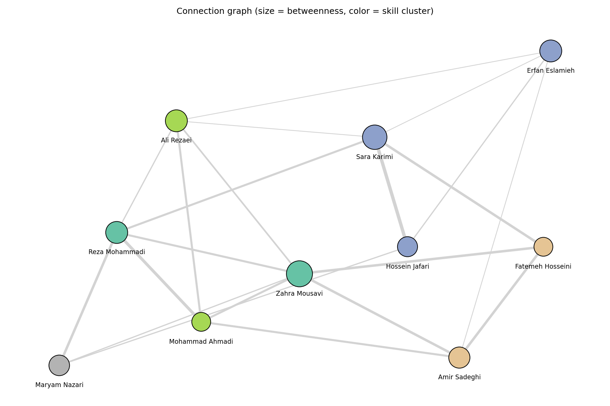

# LinkedIn Profile Analysis

Extract structured data from LinkedIn-style profiles, build a connection graph of the people,
find the key people (centrality) and group them by skills (clustering). Pure Python, no API keys, no network.



*Node size = betweenness centrality, color = skill cluster.*

## What it does

1. **Extract** (`src/extract.py`): reads 10 raw profile texts and turns each one into structured data
   (basic info, experience, education, skills, languages, interests, activity). Saves `data/profiles.json`.
2. **Analyze** (`src/analyze.py`): builds a graph of the people, computes centrality, clusters people by
   skills, and writes a picture, a JSON graph and a short report to `output/`.

## Data source

This project does **not** scrape LinkedIn. LinkedIn's terms forbid automated scraping, and collecting
personal data of real people without their consent is a privacy problem (for example under GDPR).

- **Profile 1** is my own profile. I copied the text by hand and removed contact details, links and the
  names of other people.
- **Profiles 2 to 10 are synthetic.** They were generated by an LLM with few-shot prompting: my own profile
  served as the format example, and the prompt describes a fictional Iranian company with four teams.
  All other names and companies are invented. The prompt is in [`data/GENERATION.md`](data/GENERATION.md).

The synthetic profiles are built so that the graph has something to find (shared earlier employers, shared
universities, interactions between colleagues, two "bridge" people). Because of this, the results show how
the method works, not facts about real people.

## Quick start

Python 3.10 or newer.

```bash
git clone <this-repository-url>
cd linkedin-profile-analysis
pip install -r requirements.txt

python src/extract.py    # data/all_profiles.txt -> data/profiles.json
python src/analyze.py    # data/profiles.json    -> output/graph.png, graph.json, report.md
```

Run both commands from the project root.

## Project structure

```
.
├── README.md
├── notes.md                  assumptions, design, and notes on an online version
├── requirements.txt
├── data/
│   ├── all_profiles.txt      the 10 raw profiles, one block per person
│   ├── GENERATION.md         the prompt used to create the 9 synthetic profiles
│   └── profiles.json         extracted data (output of extract.py)
├── src/
│   ├── extract.py
│   └── analyze.py
└── output/
    ├── graph.png             the connection graph
    ├── graph.json            nodes (with scores) and links
    └── report.md             tables and interpretation
```

## Extracted fields

| Section | Fields |
|---|---|
| Basic info | name, headline, location, network, about |
| Experience | title, company, start, end (`null` = current role), description |
| Education | institution, degree, field, start, end |
| Skills | list of skills |
| Languages | list with level |
| Interests | list |
| Activity | text and the people mentioned |

The script prints the number of items found in each section and warns about empty sections.
If the same person appears twice in the input file, only the first copy is used.

## How the analysis works

**Graph.** Every person is a node. Two people are linked when

- one **interacted** with the other (comment, reply, reaction, share, congratulation): weight 2,
- they worked at the same **earlier employer**: weight 1,
- they share an **institution** (university): weight 1.

Reasons add up, so a stronger relationship gets a larger weight. Names are compared ignoring case. The common
current employer is ignored, because it would link everybody to everybody. The graph is undirected.

**Key people (centrality).**

- *Degree*: how many links a person has.
- *Betweenness*: how often a person lies on the shortest path between two others, so it finds "bridges".
  It is computed without weights, because NetworkX reads a weight as a distance, while here a larger weight
  means a closer tie.
- *PageRank* (uses the weights): links to well-connected people count more.

**Clustering.** Each person is described by their skills. TF-IDF turns the skill lists into vectors and
KMeans groups similar people. The number of clusters (k = 2 to 5) is chosen with the silhouette score.

## Results

With the included data the graph has 10 people and 21 links.

- **Zahra Mousavi** (product manager) has the highest betweenness (0.15) and the highest degree.
  She works between Data Analytics and Backend, so she is the main bridge.
- **Sara Karimi** (senior ML engineer) is second (0.12). She links the ML people with the analysts and the
  backend people.
- The strongest link is **Sara Karimi - Hossein Jafari** (weight 7): several interactions plus a shared
  earlier employer.
- The 5 clusters are: the two managers (Reza Mohammadi, Zahra Mousavi), the ML/NLP people (Erfan Eslamieh,
  Sara Karimi, Hossein Jafari), the backend developers (Mohammad Ahmadi, Ali Rezaei), the data analysts
  (Fatemeh Hosseini, Amir Sadeghi), and the recruiter alone (Maryam Nazari, an outlier by skills).
- **Erfan Eslamieh** is an external node. He is linked to Sara Karimi, Ali Rezaei and Amir Sadeghi through a
  shared institution, and to Hossein Jafari through one reply.
- The best silhouette score is only 0.14, so the clusters are weak. With 10 people, the rankings and clusters
  only demonstrate the method.

See [`output/report.md`](output/report.md) for the full table.

## Online version

How extraction would work online (HTTP handling, headers, rate limiting), how a queue (Redis or Kafka) could
process the profiles, and how to store the data at scale are described in [`notes.md`](notes.md).

## Limitations

- Only 10 people, so centrality values are for demonstration and not statistically meaningful.
- Names in the activity text are found by exact string match, so nicknames are missed.
- Only k = 2 to 5 is tried for clustering, and all silhouette scores are low.
- The parser expects the section layout used in `data/all_profiles.txt`.

## 👨‍💻 **Author**

**Erfan Eslamieh**

M.Sc. in Cognitive Science – Specializing in Generative AI, Machine Learning, and Deep Learning  
📧 [erfan.cognitive.work@gmail.com]   
🔗 [](https://linkedin.com/in/erfan-eslamieh) [](https://www.kaggle.com/erfaneslamieh)
